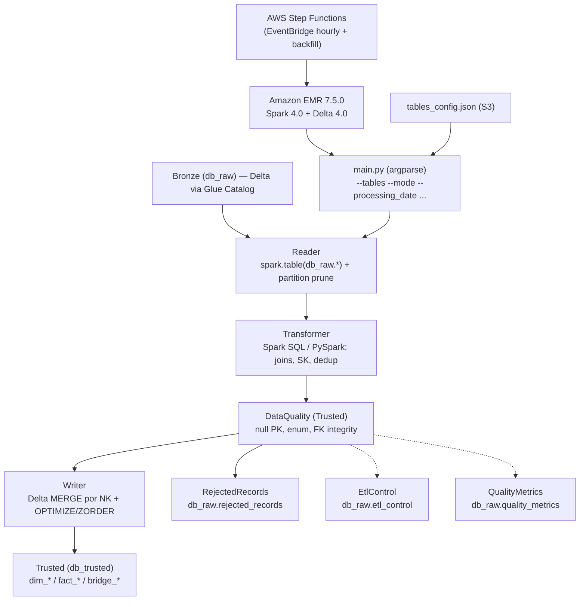
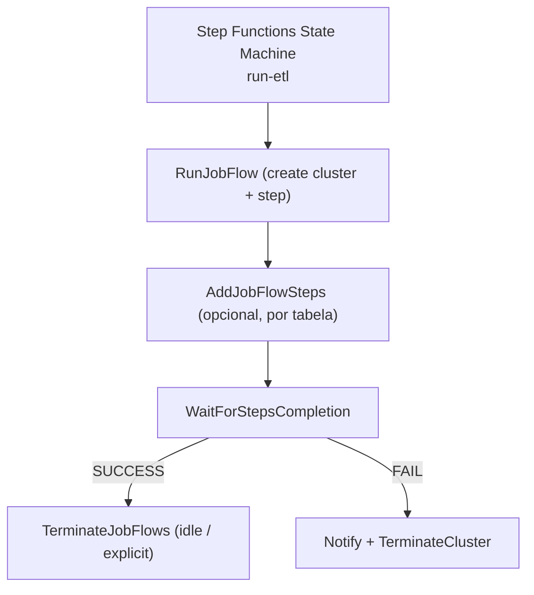
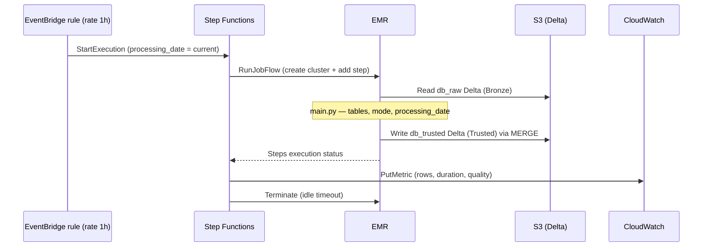

# AWS Data Architecture — EMR Trusted Layer (Bronze → Trusted)

**Author:** Jamil
**Date:** 14-09-2026
**Version:** v1.0

> Este documento descreve a camada **Trusted (`db_trusted`)** do Lakehouse, entregue por
> **Amazon EMR (Spark 4.0)** sob demanda. É um complemento ao `docs-sdd/arquitetura.md`
> (camada Bronze entregue por **AWS Glue 5.0**). A leitura é feita sobre as tabelas
> **Bronze** (`db_raw.fr_*`, formato **Delta Lake**) já consolidadas pelo pipeline Glue.

## 1 Executive Overview

**Objective:** Pipeline **batch on-demand** que lê as tabelas consolidadas do Bronze
(`db_raw`), aplica transformações de negócio e escreve **tabelas modeladas** (dimensões
conformadas, fatos e pontes) na camada **Trusted (`db_trusted`)** em **Delta Lake**,
preparadas para a futura camada **Gold**.

**Características-chave:**
- **Cluster EMR sob demanda**: criar → executar passos → terminar (auto-termination idle).
- **Parametrizado**: tabela(s), modo (`full`/`incremental`), data, database, sizing do cluster.
- **Catálogo**: Glue Data Catalog (`db_raw` e `db_trusted`) + Lake Formation governance.
- **Orquestração**: AWS Step Functions (execução horária + backfill).
- **Logs**: S3 para Spark Event Logs (Spark UI) e CloudWatch para logs do job/metadados.
- **Transformação**: Spark SQL e PySpark API, com `tables_config.json` dirigindo os contratos de dados.
- **Idempotência**: Delta `MERGE` por chave natural em todas as escritas.

## 2 Contexto e Relação com o Pipeline Existente (Glue)

O pipeline atual (`docs-sdd/`) replica o schema `flight_radar` do Aurora em Delta Lake no
**db_raw** (Bronze) com CDC (U/I/D) já consolidado via `MERGE` por PK composta (`cod_unique`).
As tabelas Bronze disponíveis são:

| Bronze (db_raw) | PK/Natural Key | Partição | Volumetria |
|---|---|---|---|
| `fr_aircraft` | `icao24` | `event_date` | Baixa |
| `fr_airports` | `icao_code` | `event_date` | Baixa |
| `fr_airlines` | `icao_code` | `event_date` | Baixa |
| `fr_flights` | `flight_id` | `event_date` (`scheduled_departure`) | Média |
| `fr_aircraft_positions` | `position_id` + `recorded_at` | `aircraft_icao24` | **Alta (150 MB/min CDC)** |
| `fr_countries` | `id` | `event_date` | Baixa |
| `fr_aircraft_types` | `icao_code` | `event_date` | Baixa |
| `fr_routes` | `id` | `event_date` | Média |

> O EMR **não** lê o landing bucket de DMS. Ele lê **apenas** as tabelas Delta catalogadas
> em `db_raw`. Isso desacopla a Trusted da forma física de ingestão (DMS).

## 3 Componentes e Responsabilidades

- **Fonte (input da Trusted):** `db_raw.fr_*` — Delta Lake via Glue Data Catalog.
- **Processamento:** EMR 7.5.0 (Spark 4.0, Scala 2.13, Delta Lake 4.0) — `app/`.
- **Destino (output da Trusted):** `db_trusted.dim_*`, `fact_*`, `bridge_*` + tabelas de suporte.
- **Orquestração:** AWS Step Functions (hourly + backfill sob demanda).
- **Governança:** Glue Data Catalog + Lake Formation (roles/policies específicas do projeto).
- **Observabilidade:** S3 (Spark Event Logs / Spark UI), CloudWatch (logs, métricas, alarmes).
- **Segurança:** IAM least-privilege (Service/EC2/Job), SSE-KMS, EBS encryption, VPC privado.

## 4 Camadas do Lakehouse (Medallion)

```
Landing (S3)  →  Bronze (db_raw)     →  Trusted (db_trusted)   →  Gold (futuro)
   DMS Parquet     Glue 5.0 (Delta)      EMR 7.5.0 (Delta)        (Redshift/Athena/APIs)
```

| Layer | Bucket | Database | Formato | Escrito por |
|---|---|---|---|---|
| Landing | `lakehouse-landing-{account_id}` | — | Parquet (DMS) | DMS Serverless |
| Bronze | `lakehouse-raw-{account_id}` | `db_raw` | Delta Lake | Glue 5.0 |
| **Trusted** | `lakehouse-trusted-{account_id}` | `db_trusted` | **Delta Lake** | **EMR 7.5.0** |
| Workspace | `lakehouse-workspace-{account_id}` | — | artifacts/config/checkpoint | Terraform/CI |
| Logs | `lakehouse-logs-{account_id}` | — | Spark EventLog + cluster logs | EMR |

## 5 Fluxo de Processamento (Mermaid)



## 6 Ciclo de Vida do Cluster (Step Functions)



## 7 Decisões de Arquitetura

1. **EMR sob demanda (job flow por execução), não cluster dedicado.** Custo sob controle,
   auto-termination por idle e sizing parametrizado por execução (full vs incremental).
2. **Spark 4.0 / Scala 2.13 / Delta Lake 4.0** — compatível com Glue 5.0 (que já usa Spark 4.0)
   e cliente de catálogo uniforme (`spark_catalog` → Glue Data Catalog) nas duas camadas.
3. **Glue Data Catalog** como metastore único (Hive Metastore) para `db_raw` e `db_trusted`.
4. **Idempotência** via Delta `MERGE` por chave natural, `schemaMode=merge` e partition pruning.
5. **Chaves naturais (NK)** para merge; **chaves substitutas (SK)** determinísticas (`xxhash64`)
   para joins entre dimensões e fatos.
6. **Ordem de execução**: dimensões conformadas primeiro, depois fatos/pontes (via `order` e `dependencies`).
7. **Observabilidade herdada**: Spark Event Logs em S3 (Spark UI histórico) + CloudWatch.
8. **Segurança**: Lake Formation para `db_trusted`, roles separadas, mínimo privilégio.

## 8 EMR — Provisionamento, Execução e Terminação

O `aws_emr_cluster` usa `auto_termination` (idle) como mecanismo de segurança e a Step Functions
controla o ciclo de vida explícito:



## 9 Mapeamento de Tabelas (Bronze → Trusted)

| Bronze (db_raw) | Trusted (db_trusted) | Tipo | Modelagem |
|---|---|---|---|
| `fr_aircraft_types` | `dim_aircraft_type` | Dimensão conformada | SCD Tipo 1 |
| `fr_aircraft` + `fr_aircraft_types` | `dim_aircraft` | Dimensão conformada | SCD Tipo 1 |
| `fr_airports` | `dim_airport` | Dimensão conformada | SCD Tipo 1 |
| `fr_airlines` | `dim_airline` | Dimensão conformada | SCD Tipo 1 |
| `fr_countries` | `dim_country` | Dimensão conformada | SCD Tipo 1 |
| `fr_routes` + `fr_airports` | `dim_route` | Dimensão conformada | SCD Tipo 1 |
| (gerada) | `dim_date` | Dimensão tempo | snapshot |
| `fr_flights` + dimensões | `fact_flight` | Fato | CDC incremental |
| `fr_aircraft_positions` + dims | `fact_flight_position` | Fato | particionada |
| `fr_flights` (status changes) | `fact_flight_status` (opcional) | Fato | SCD Tipo 2 |
| `fr_flights` + dims | `bridge_flight_aircraft` / `bridge_flight_route` (opcional) | Ponte | — |

## 10 Segurança e Governança

- **IAM**: papéis separados — `EMR_EC2_DefaultRole` (nós), `role-emr-flight-radar` (serviço EMR),
  instance profile EC2. Políticas least-privilege: `s3:GetObject` em `db_raw`, `s3:PutObject` em
  `db_trusted`, Glue Catalog (`db_raw`, `db_trusted`), KMS, CloudWatch Logs/Metrics, STS.
- **Lake Formation**: já configurado; criar grants para as roles EMR — `SELECT` em `db_raw` e
  `ALL` em `db_trusted`. Políticas column/row-level sobre o `db_trusted`.
- **Encryption**: SSE-KMS nos buckets; EBS + logs encryption; security configuration do EMR.
- **Network**: subnets privadas + security group dedicado; VPC endpoints (S3, Glue, CloudWatch, STS, KMS).

## 11 SLA, Sizing e Custos

| Métrica | Valor |
|---|---|
| Frequência | diária (incremental) + full/backfill manual |
| Volume | full = 5 GB parquet/delta; CDC = ~150 MB/min |
| SLA | incremental ≤ 20 min; full ≤ 20 min |
| Instâncias | Core `m6g.2xlarge` (default 3; managed scaling min 2 / max 10) |
| Custo | sem restrição; Graviton (m6g/r6g) e spot (opcional) para reduzir custo |

## 12 Riscos e Recomendações

1. **EMR / Spark 4.0 / Delta 4.0**: validar release label (`emr-7.5.0`) e artefato Delta
   (`io.delta:delta-spark_2.13:4.0.0`) no deployment — as versões de aplicativos variam.
2. **Volumetria de posições** (~150 MB/min CDC): ler por `recorded_at` e aplicar
   `ZORDER(aircraft_icao24, recorded_at)`; considerar um step dedicado para `fact_flight_position`.
3. **Reparticionamento**: `fr_aircraft_positions` é particionada por `aircraft_icao24` no Bronze;
   filtros de reprocessamento devem usar range de `recorded_at`, não `event_date`.
4. **Governança**: `db_trusted` deve existir e estar permissionada (Lake Formation) antes do go-live.
5. **Sem homologação**: validar com cluster pequeno / spot e tag `environment` antes de produção.

## 13 Convenções e Regras

- Não usar `DROP`/`TRUNCATE` em `db_trusted` durante o ETL (idempotência via `MERGE`).
- Registrar `processing_date`/`reference_date` no `db_raw.etl_control` para reprocessamento.
- Gerar `trusted_ingestion_ts` e `trusted_process_engine` em todas as tabelas.
- Buckets obedecem ao padrão `lakehouse-{tier}-{account_id}`.

---

**Fim do documento.** Salve como `arquitetura-emr.md`.