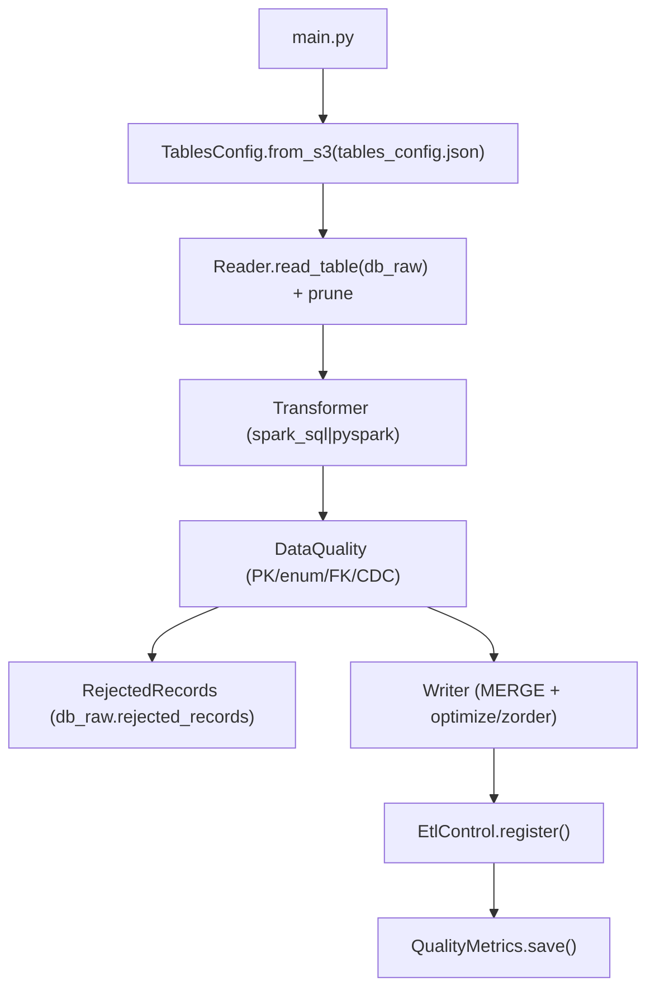

# Feature: EMR Trusted Layer (Bronze → Trusted)

## 1. Description

**Amazon EMR 7.5.0 (Spark 4.0 + Delta Lake 4.0)** job **batch on-demand** que lê as tabelas
consolidadas do **Bronze** (`db_raw.fr_*`, Delta), aplica transformações de negócio e escreve
**tabelas modeladas** na camada **Trusted** (`db_trusted`) em **Delta Lake**, preparadas para a
futura camada Gold (`dim_*` conformadas, `fact_*`, `bridge_*`).

> O job é executado em um **cluster EMR sob demanda** (criar → passo → terminar), orquestrado
> por **AWS Step Functions** (horário + backfill manual). Não há streaming no EMR: o consumo de
> CDC é feito de forma incremental a partir do `db_raw` (que já consolida CDC via Glue).

## 2. Contexto

O pipeline Glue (`docs-sdd/`) entrega as 8 tabelas Bronze no `db_raw`, cada uma com `cod_unique`
e `cdc_operation` (U/I/D). A Trusted modela essas tabelas de staging em um esquema dimensional
(Star/Snowflake): dimensões conformadas com chaves substitutas (SK) e fatos com as FKs resolvidas.

A transformação é dirigida por `tables_config.json` (contrato de dados), via:
- **Spark SQL** (`transform_type = spark_sql`) para queries declarativas (dimensões).
- **PySpark API** (`transform_type = pyspark`) para lógica procedimental (fatos com multi-joins).

## 3. Data Source (db_raw → read)

O `reader.py` lê via `spark.table("db_raw.<table>")` e aplica **partition pruning**:

- Dimensões e `fact_flight`: filtrar por `event_date`.
- `fr_aircraft_positions`: filtrar por range `recorded_at` (partição Bronze = `aircraft_icao24`).

Renomeio de colunas CDC (DMS → colunas finais):

| Landing (DMS) | Bronze (db_raw) | Usado na Trusted |
|---|---|---|
| `Op` | `cdc_operation` | filtro `<> 'D'` (soft delete) |
| `dms_timestamp` | `cdc_timestamp` | watermark |

## 4. Destination Tables (db_trusted)

| Tabela Trusted | Fonte(s) Bronze | PK (merge) | SK | Partição |
|---|---|---|---|---|
| `dim_aircraft_type` | `fr_aircraft_types` | `icao_code` | `aircraft_type_key` | `event_date` |
| `dim_aircraft` | `fr_aircraft` ⋈ `fr_aircraft_types` | `icao24` | `aircraft_key` | `event_date` |
| `dim_airport` | `fr_airports` | `icao_code` | `airport_key` | `event_date` |
| `dim_airline` | `fr_airlines` | `icao_code` | `airline_key` | `event_date` |
| `dim_country` | `fr_countries` | `id` | `country_key` | `event_date` |
| `dim_route` | `fr_routes` ⋈ `fr_airports` | `id` | `route_key` | `event_date` |
| `dim_date` | gerada | `date_key` | — | — |
| `fact_flight` | `fr_flights` ⋈ dim | `flight_id` | — | `event_date` (`scheduled_departure`) |
| `fact_flight_position` | `fr_aircraft_positions` ⋈ dim | `position_id`, `recorded_at` | — | `event_date` (`recorded_at`) |
| `fact_flight_status` (opcional) | `fr_flights` (status changes) | `flight_id`, `status_change_ts` | — | `event_date` |
| `bridge_flight_aircraft` / `bridge_flight_route` (opcional) | `fr_flights` ⋈ dim | — | — | `event_date` |

**Formato:** Delta Lake. **Dedup/idempotência:** `MERGE` por natural key + `QUALIFY ROW_NUMBER()`
(estado vigente SCD T1). Sem `DROP`/`TRUNCATE`.

## 5. Job Estrutura

### 5.1 Arquivos de configuração

| Arquivo | Conteúdo | Classe |
|---|---|---|
| `tables_config.json` | Contrato por tabela (sources, PK, SK, partition, transform, dependencies) | `TablesConfig` |
| `sql/*.sql` | Transformações `spark_sql` | — |
| `jobs/*.py` | Transformações `pyspark` | — |

### 5.2 Classes

| Classe | Arquivo | Responsabilidade |
|---|---|---|
| `TablesConfig` | config_models.py | Load `tables_config.json`, retorna `TableConfig` |
| `TableConfig` | config_models.py | Configuração de uma tabela target |
| `Reader` | reader.py | Lê `db_raw` (Delta) com partition prune |
| `Transformer` | transformer.py | Spark SQL / PySpark transform (SK, joins, dedup) |
| `DataQuality` | data_quality.py | Validações Trusted (null PK, enum, FK) |
| `Writer` | writer.py | Escreve `db_trusted` (Delta MERGE + optimize/zorder) |
| `RejectedRecords` | rejected_records.py | Centraliza `db_raw.rejected_records` |
| `EtlControl` | etl_control.py | Registra execução `db_raw.etl_control` |
| `QualityMetrics` | quality_metrics.py | Salva `db_raw.quality_metrics` |
| `Pipeline` | pipeline.py | Executa ETL para uma tabela |
| `PipelineRunner` | pipeline.py | Orquestra múltiplas tabelas |
| `main.py` | main.py | Entry point: argparse, `_init_spark`, `PipelineRunner` |
| `aws_helper.py` | aws_helper.py | boto3 utilities |

### 5.3 Pipeline (mermaid)



### 5.4 Infraestrutura (Terraform)

| Resource | Arquivo (infra/emr) | Descrição |
|---|---|---|
| `aws_emr_cluster.main` | emr_cluster.tf | emr-7.5.0, Spark/Delta, Private subnets, managed scaling |
| `aws_emr_security_configuration` | emr_security.tf | encryption (S3/EBS/logs) |
| `aws_iam_role.*` / policies | iam.tf | least-privilege |
| `aws_s3_bucket.*` | s3.tf | artifacts/logs |
| `aws_cloudwatch_*` | cloudwatch.tf | logs + alarms |
| `aws_sfn` + EventBridge | stepfunctions.tf | orquestração `run-etl` |

> Glue Catalog databases (`db_trusted`) e tabelas **não são criados pelo Terraform** — já existem.
> O Writer **falha** se a tabela não existir no Glue Catalog.

### 5.5 Spark Configs (--conf)

Aplicados via `spark-submit` no step e mantendo uniformes com o Glue (`docs-sdd/spec.md`):

```
spark.sql.extensions=io.delta.sql.DeltaSparkSessionExtension
spark.sql.catalog.spark_catalog=org.apache.spark.sql.delta.catalog.DeltaCatalog
spark.delta.logStore.class=org.apache.spark.sql.delta.storage.S3SingleDriverLogStore
spark.sql.adaptive.enabled=true
spark.sql.adaptive.coalescePartitions.enabled=true
spark.sql.shuffle.partitions=200
spark.databricks.delta.optimizeWrite.enabled=true
spark.databricks.delta.autoCompact.enabled=true
spark.eventLog.enabled=true
spark.eventLog.dir=s3://${logs_bucket}/emr/spark-events/
```

## 6. Quality Rules (DataQuality Trusted)

| Rule | Descrição | Ação para inválidos |
|---|---|---|
| PK null | Natural key (`primary_key`) null | Reject |
| CDC op | `Op = 'D'` (soft delete) | Drop (não insert) |
| Enum | Valor fora da lista (`enum_columns`) | Reject |
| FK integrity | FK não resolve na dimensão (left join null) | Reject (tabela FK failures) |
| Tipo | Cast falha | Reject |

> A unicidade é garantida por `MERGE` + `QUALIFY ROW_NUMBER()`, não por `dropDuplicates`.

## 7. Support Tables (db_trusted)

### 7.1 `db_raw.etl_control` (reutiliza tabela Bronze)

| Column | Type | Descrição |
|---|---|---|
| `execution_id` | STRING | UUID execução |
| `job_name` | STRING | `emr-flight-radar` |
| `source` | STRING | tabela Trusted alvo (ex: `dim_aircraft`) |
| `target_table` | STRING | tabela destino |
| `mode` | STRING | `full` / `incremental` |
| `execution_start/end` | TIMESTAMP | início/fim |
| `status` | STRING | `running/success/failed` |
| `records_read/written/rejected` | BIGINT | contagens |
| `error_message` | STRING | mensagem (se houver) |
| `reference_date` | DATE | partição (reference_date) |

### 7.2 `db_raw.quality_metrics` (reutiliza tabela Bronze)

| Column | Tipo |
|---|---|
| `database` | STRING |
| `table` | STRING |
| `processing_timestamp` | TIMESTAMP |
| `metric` | STRING |
| `rule` | STRING |
| `status` | STRING |
| `failure_reason` | STRING |
| `partition` | STRING |
| `technology` | STRING (`emr`) |
| `reference_date` | DATE |

### 7.3 `db_raw.rejected_records` (reutiliza tabela Bronze)

| Column | Tipo |
|---|---|
| `execution_id` | STRING |
| `execution_timestamp` | TIMESTAMP |
| `source_database` | STRING |
| `source_table` | STRING |
| `target_database` | STRING |
| `target_table` | STRING |
| `reject_rule` | STRING |
| `reject_reason` | STRING |
| `rejected_record_json` | STRING |
| `reference_date` | DATE |

## 8. Acceptance Criteria

| # | Critério |
|---|---|
| 1 | Lê tabelas `db_raw` Delta via Glue Data Catalog |
| 2 | Processa `full` e `incremental` (filtro `processing_date`) |
| 3 | Aplica partition pruning (event_date / recorded_at) |
| 4 | Escreve Delta em `db_trusted` com `MERGE` por natural key |
| 5 | Permite `--tables` (uma, várias, `all`) |
| 6 | Gera `trusted_ingestion_ts` e `trusted_process_engine` |
| 7 | Registra execução em `db_raw.etl_control` |
| 8 | Salva métricas em `db_raw.quality_metrics` |
| 9 | Rejeitos centralizados em `db_raw.rejected_records` |
| 10 | Logs (job + Spark UI) no S3 |
| 11 | Cluster com managed scaling + auto-termination |
| 12 | Terraform module `infra/emr/` idempotente |
| 13 | Orquestração Step Functions + EventBridge |

## 9. Dependencies

- `db_raw` (`lakehouse-raw-{account_id}`) → leitura.
- `db_trusted` (`lakehouse-trusted-{account_id}`) → escrita.
- `lakehouse-workspace-{account_id}` → scripts/config/checkpoints.
- `lakehouse-logs-{account_id}` → Spark Event Logs / cluster logs.
- IAM roles EMR (service + EC2 instance profile) com least privilege e Lake Formation grants.
- VPC existente (private subnets + SG + endpoints).

---

**Fim do documento.** Salve como `feature-emr.md`.