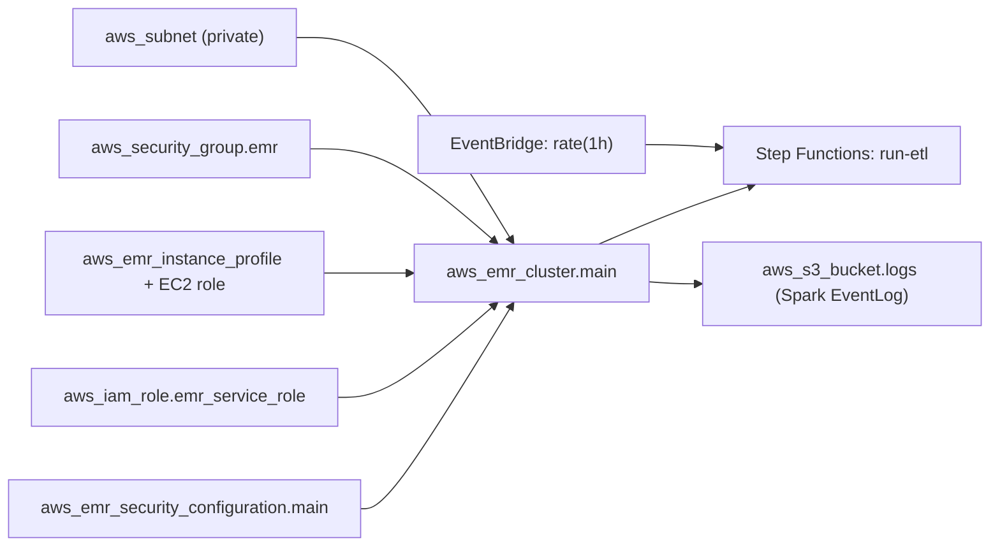

# Implementation Plan — EMR Trusted Layer

> Gerado a partir de `spec-emr.md`.

## Project Structure

```
app/
├── src/
│   ├── main.py                      # Entry point (argparse + Spark init + PipelineRunner)
│   ├── __init__.py
│   ├── dependencies/
│   │   ├── __init__.py
│   │   ├── config_models.py         # Dataclasses (TablesConfig, TableConfig)
│   │   ├── config/
│   │   │   ├── __init__.py
│   │   │   └── tables_config.json
│   │   ├── sql/                     # SQL files (transform_type = spark_sql)
│   │   │   ├── dim_aircraft.sql
│   │   │   ├── dim_airport.sql
│   │   │   ├── dim_airline.sql
│   │   │   ├── dim_route.sql
│   │   │   ├── dim_country.sql
│   │   │   ├── dim_aircraft_type.sql
│   │   │   └── dim_date.sql
│   │   ├── reader.py
│   │   ├── transformer.py
│   │   ├── writer.py
│   │   ├── data_quality.py
│   │   ├── etl_control.py
│   │   ├── quality_metrics.py
│   │   ├── rejected_records.py
│   │   ├── aws_helper.py
│   │   └── pipeline.py              # Pipeline + PipelineRunner
│   └── jobs/                        # transform_type = pyspark
│       ├── __init__.py
│       ├── process_dim_aircraft.py
│       ├── process_dim_airport.py
│       ├── process_dim_airline.py
│       ├── process_dim_route.py
│       ├── process_dim_country.py
│       ├── process_dim_date.py
│       ├── process_fact_flight.py
│       └── process_fact_flight_position.py
└── tests/
    ├── __init__.py
    ├── conftest.py
    ├── unit/
    │   ├── test_config.py
    │   ├── test_reader.py
    │   ├── test_transformer.py
    │   ├── test_data_quality.py
    │   ├── test_writer.py
    │   └── test_main_args.py
    └── integration/
        ├── conftest.py
        ├── test_emr_step.py
        └── test_pipeline_e2e.py
infra/
└── emr/                              # Módulo EMR Trusted
    ├── main.tf
    ├── emr_cluster.tf
    ├── emr_step.tf
    ├── emr_security.tf
    ├── iam.tf
    ├── s3.tf
    ├── vpc.tf
    ├── cloudwatch.tf
    ├── stepfunctions.tf
    ├── variables.tf
    ├── outputs.tf
    ├── locals.tf
    ├── versions.tf
    └── terraform.tfvars
ci-cd/
├── deploy-emr.sh                     # deploy/apply Terraform + upload artifacts
└── rollback-emr.sh                   # destroy (sem remoção de dados Trusted)
docs-sdd-emr/                         # esta documentação
```

## Deployment Structure (S3 Workspace Bucket)

```
lakehouse-workspace-{account_id}/
├── aws-emr/
│   └── flight-radar/
│       ├── jobs/
│       │   └── main.py
│       ├── dependencies/
│       │   └── emr_helpers.zip       # package de src/dependencies/ + src/jobs/
│       └── config/
│           └── tables_config.json
```

## Configuration (tables_config.json)

Arquivo único no workspace bucket; veja `tables_config_schema.md` para o schema completo.
Resumo:

```json
[
  {
    "target_table": "dim_aircraft_type",
    "source_tables": ["fr_aircraft_types"],
    "primary_key": ["icao_code"],
    "surrogate_key": { "name": "aircraft_type_key", "col": "icao_code" },
    "partition_keys": [{"name": "event_date", "type": "date"}],
    "transform_type": "spark_sql",
    "transform_query": "sql/dim_aircraft_type.sql",
    "dependencies": [],
    "order": 1
  },
  {
    "target_table": "dim_aircraft",
    "source_tables": ["fr_aircraft", "fr_aircraft_types"],
    "primary_key": ["icao24"],
    "surrogate_key": { "name": "aircraft_key", "col": "icao24" },
    "partition_keys": [{"name": "event_date", "type": "date"}],
    "transform_type": "spark_sql",
    "transform_query": "sql/dim_aircraft.sql",
    "dependencies": ["dim_aircraft_type"],
    "order": 2
  },
  {
    "target_table": "fact_flight",
    "source_tables": ["fr_flights"],
    "primary_key": ["flight_id"],
    "partition_keys": [{"name": "event_date", "type": "date", "source_column": "scheduled_departure"}],
    "transform_type": "pyspark",
    "transform_module": "jobs.process_fact_flight",
    "dependencies": ["dim_airline", "dim_aircraft", "dim_airport", "dim_route"],
    "order": 10,
    "enable_zorder": true,
    "zorder_cols": ["flight_id"],
    "enum_columns": { "status": ["scheduled", "active", "landed", "cancelled", "diverted"] }
  }
]
```

## Core Module Implementation

### `config_models.py`

| Classe | Campos |
|---|---|
| `ColumnSpec` | name, type, nullable, comment |
| `PartitionSpec` | name, type, source_column |
| `SurrogateKeySpec` | name, col |
| `TableConfig` | target_table, source_tables, primary_key, surrogate_key, merge_fallback_keys, partition_keys, transform_type/query/module, dependencies, order, enable_zorder, zorder_cols, enum_columns |
| `TablesConfig` | `_tables`, `tables` (order), `get_table(name)`, `from_s3()`, `resolve_tables()`, `to_dict()` |

### `reader.py`

- `read_table(spark, database, table, mode, processing_date)`.
- Partition prune: `event_date` (dims/facts) ou `recorded_at` (posições).
- Renomeia colunas DMS/CDC para colunas finais usadas nas transformações.

### `transformer.py`

- `transform(spark, table: TableConfig, raw_db, trusted_db, processing_date, mode)`.
- `spark_sql` → executa SQL via `spark.sql(...)` usando `sql/...` do workspace.
- `pyspark` → importa módulo `jobs.` dinamicamente.

### `writer.py`

- `verify_table_exists()` → `DeltaTable.forName()` (read-only metadata check).
- `merge_delta()` → MERGE com `whenMatchedUpdateAll()` + `whenNotMatchedInsertAll()`.
- **Sem bootstrap** — falha se tabela não existir no Glue Catalog.
- `write_rejects()` → `db_raw.rejected_records` via MERGE append.
- `optimize()`, `zorder()`, `vacuum()`.

### `data_quality.py`

| # | Method | Descrição |
|---|---|---|
| 1 | `_check_pk_not_null` | drop records sem natural key |
| 2 | `_check_cdc_operation` | drop `Op = 'D'` |
| 3 | `_check_enums` | valida `enum_columns` |
| 4 | `_check_fk_integrity` | FKs resolvidas depois dos joins |

### `etl_control.py`, `quality_metrics.py`, `rejected_records.py`

Reuso dos contratos do Glue (`docs-sdd/spec.md`), reutilizando as tabelas do `db_raw`
(`etl_control`, `quality_metrics`, `rejected_records`).

### `pipeline.py`

| Classe | Responsabilidade |
|---|---|
| `Pipeline` | Executa ETL completo para uma tabela (Reader → Transformer → DQ → Writer → EtlControl/QualityMetrics) |
| `PipelineRunner` | Orquestra múltiplas tabelas (resolve dependências, executa em ordem) |

### `main.py`

Thin entry point:
- `_parse_args()` (argparse)
- `_init_spark()` com Delta extensions
- `TablesConfig.from_s3(config_s3_path)`
- `_resolve_processing_date(args)`
- `PipelineRunner(...).run(args.tables)`

## Infrastructure as Code (Terraform) — resumo

| Resource | File | Descrição |
|---|---|---|
| `aws_emr_cluster.main` | emr_cluster.tf | emr-7.5.0, Spark/Delta, managed scaling, auto-termination |
| `aws_emr_security_configuration.main` | emr_security.tf | encryption (S3/EBS/logs) |
| `aws_iam_role.emr_service` / `aws_emr_ec2_role` / instance profile | iam.tf | roles separadas |
| `aws_s3_bucket.artifacts/logs` | s3.tf | buckets EMR + lifecycle |
| `aws_cloudwatch_log_group` + metric filter + alarm | cloudwatch.tf | logs + alertas |
| `aws_sfn` + EventBridge rule | stepfunctions.tf | orquestração `run-etl` |

## Diagrama de Infraestrutura (Mermaid)



## Timeline

| Phase | Tasks | Proveniente |
|---|---|---|
| Phase 1 | Structure dirs + `tables_config.json` + `tables_config_schema.md` | — |
| Phase 2 | Python modules (`config_models`, reader, transformer, writer, dq, etl, metrics, rejects, pipeline) | — |
| Phase 3 | Terraform EMR (cluster, IAM, S3, security, SFN, CloudWatch) | — |
| Phase 4 | Unit + integration tests | — |
| Phase 5 | `deploy-emr.sh` + `rollback-emr.sh` | — |
| Phase 6 | Validação + go-live (cluster pequeno/spot) | — |

## Deliverables

| # | Entrega | Status |
|---|---|---|
| 1 | `app/src/main.py` + `dependencies/` + `jobs/` | ✅ |
| 2 | `app/src/dependencies/config/tables_config.json` | ✅ |
| 3 | `app/src/dependencies/sql/*.sql` | ✅ |
| 4 | `infra/emr/` (Terraform module) | ✅ |
| 5 | `tests/unit/` e `tests/integration/` | ✅ |
| 6 | `ci-cd/deploy-emr.sh` + `rollback-emr.sh` | ✅ |
| 7 | `docs-sdd-emr/` (this directory) | ✅ (draft) |

---

**Fim do documento.** Salve como `plan-emr.md`.