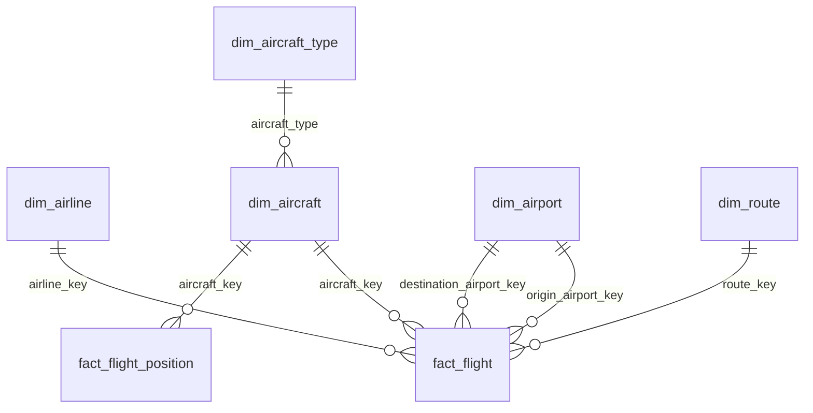

# Modelagem Dimensional — Camada Trusted (`db_trusted`)

> Mapeamento **Bronze → Trusted** baseado **exclusivamente** nas colunas reais de `db_raw`
> (configuração das tabelas Bronze). As colunas técnicas do Bronze
> (`cod_unique`, `cdc_operation`, `cdc_timestamp`) **não** são propagadas para a Trusted —
> são usadas apenas como filtro/watermark durante a transformação.

## 1. Convenções

1. **Natural Key (NK)** → usada como chave de `MERGE` (idempotência).
2. **Surrogate Key (SK)** → `bigint`, derivada determinística por `xxhash64(NK)`,
   usada como FK nos fatos (joins econômicos).
3. **SCD Tipo 1** nas dimensões (estado vigente; dedup por `QUALIFY ROW_NUMBER()`).
4. **`trusted_ingestion_ts` + `trusted_process_engine`** em todas as tabelas.
5. **`event_date`** = `to_date(coalesce(updated_at, created_at, processing_date))` para dims;
   `to_date(<fato timestamp>)` para fatos.
6. **Soft delete**: `WHERE cdc_operation <> 'D'`.
7. **Partição**: `event_date` (dims/fatos) — exceção `fact_flight_position` usa `event_date`
   = `date(recorded_at)`.

```python
def surrogate(col_name):
    return F.xxhash64(F.col(col_name)).cast("bigint")
```

> ✅ Colisão de hash: para tabelas dimensionais (escala pequena), risco de colisão
> `xxhash64` é negligenciável. Em caso de conflito, use a própria NK como chave.

## 2. Dimensões Conformadas

### 2.1 `dim_aircraft_type` ← `fr_aircraft_types`

| Trusted column | Bronze source | Tipo | Descrição |
|---|---|---|---|
| `aircraft_type_key` | xxhash64(`icao_code`) | BIGINT | SK |
| `icao_code` | `icao_code` | STRING | NK |
| `iata_code` | `iata_code` | STRING | — |
| `type_name` | `name` | STRING | Nome do modelo |
| `manufacturer` | `manufacturer` | STRING | — |
| `created_at` | `updated_at` | TIMESTAMP | — |
| `trusted_ingestion_ts` | — | TIMESTAMP | `current_timestamp()` |
| `trusted_process_engine` | — | STRING | `'EMR_SPARK'` |
| `event_date` | — | DATE | — |

```sql
CREATE TABLE db_trusted.dim_aircraft_type (
  aircraft_type_key BIGINT,
  icao_code         STRING,
  iata_code         STRING,
  type_name         STRING,
  manufacturer      STRING,
  updated_at        TIMESTAMP,
  trusted_ingestion_ts TIMESTAMP,
  trusted_process_engine STRING,
  event_date        DATE
) USING DELTA PARTITIONED BY (event_date);
```

### 2.2 `dim_aircraft` ← `fr_aircraft` ⋈ `fr_aircraft_types`

| Coluna Trusted | Bronze | Tipo |
|---|---|---|
| `aircraft_key` | xxhash64(`a.icao24`) | BIGINT |
| `icao24` | `a.icao24` | STRING |
| `registration` | `a.registration` | STRING |
| `aircraft_type` | `a.aircraft_type` | STRING |
| `type_iata_code` | `at.iata_code` | STRING |
| `type_name` | `at.name` | STRING |
| `manufacturer` | `at.manufacturer` | STRING |
| `serial_number` | `a.serial_number` | STRING |
| `operator_icao` | `a.operator_icao` | STRING |
| `operator_name` | `a.operator_name` | STRING |
| `year_built` | `a.year_built` | INT |
| `created_at` | `a.created_at` | TIMESTAMP |
| `updated_at` | `a.updated_at` | TIMESTAMP |
| `trusted_ingestion_ts` | — | TIMESTAMP |
| `trusted_process_engine` | — | STRING |
| `event_date` | — | DATE |

```sql
CREATE TABLE db_trusted.dim_aircraft (
  aircraft_key BIGINT,
  icao24 STRING,
  registration STRING,
  aircraft_type STRING,
  type_iata_code STRING,
  type_name STRING,
  manufacturer STRING,
  serial_number STRING,
  operator_icao STRING,
  operator_name STRING,
  year_built INT,
  created_at TIMESTAMP,
  updated_at TIMESTAMP,
  trusted_ingestion_ts TIMESTAMP,
  trusted_process_engine STRING,
  event_date DATE
) USING DELTA PARTITIONED BY (event_date);
```

### 2.3 `dim_airport` ← `fr_airports`

| Coluna Trusted | Bronze | Tipo |
|---|---|---|
| `airport_key` | xxhash64(`icao_code`) | BIGINT |
| `icao_code` | `icao_code` | STRING |
| `iata_code` | `iata_code` | STRING |
| `ident` | `ident` | STRING |
| `type` | `type` | STRING |
| `name` | `name` | STRING |
| `latitude_deg` | `latitude_deg` | DECIMAL |
| `longitude_deg` | `longitude_deg` | DECIMAL |
| `elevation_ft` | `elevation_ft` | INT |
| `continent` | `continent` | STRING |
| `iso_country` | `iso_country` | STRING |
| `iso_region` | `iso_region` | STRING |
| `municipality` | `municipality` | STRING |
| `scheduled_service` | `scheduled_service` | BOOLEAN |
| `gps_code` | `gps_code` | STRING |
| `local_code` | `local_code` | STRING |
| `home_link` | `home_link` | STRING |
| `wikipedia_link` | `wikipedia_link` | STRING |
| `trusted_ingestion_ts` | — | TIMESTAMP |
| `trusted_process_engine` | — | STRING |
| `event_date` | — | DATE |

> ⚠️ Quando `icao_code` é null (raros aeroportos regionais), o merge cai no `id`. Documentado no
> `tables_config.json` como `merge_fallback_keys`.

### 2.4 `dim_airline` ← `fr_airlines`

| Coluna Trusted | Bronze | Tipo |
|---|---|---|
| `airline_key` | xxhash64(`icao_code`) | BIGINT |
| `icao_code` | `icao_code` | STRING |
| `iata_code` | `iata_code` | STRING |
| `name` | `name` | STRING |
| `alias` | `alias` | STRING |
| `callsign` | `callsign` | STRING |
| `country` | `country` | STRING |
| `is_active` | `is_active` | BOOLEAN |
| `created_at` | `created_at` | TIMESTAMP |
| `trusted_ingestion_ts` | — | TIMESTAMP |
| `trusted_process_engine` | — | STRING |
| `event_date` | — | DATE |

### 2.5 `dim_country` ← `fr_countries`

| Coluna Trusted | Bronze | Tipo |
|---|---|---|
| `country_key` | xxhash64(`id`) | BIGINT |
| `id` | `id` | INT |
| `code` | `code` | STRING |
| `name` | `name` | STRING |
| `continent` | `continent` | STRING |
| `wikipedia_link` | `wikipedia_link` | STRING |
| `trusted_ingestion_ts` | — | TIMESTAMP |
| `trusted_process_engine` | — | STRING |
| `event_date` | — | DATE |

### 2.6 `dim_route` ← `fr_routes` ⋈ `fr_airports` (origin/dest)

A tabela `fr_routes` usa IDs internos (`src_airport_id`, `dst_airport_id`) e códigos IATA
(`src_airport`, `dst_airport`). O join com `fr_airports` resolve a **ICAO** e o **id**:

| Coluna Trusted | Bronze | Tipo |
|---|---|---|
| `route_key` | xxhash64(`r.id`) | BIGINT |
| `route_id` | `r.id` | BIGINT |
| `airline_iata` | `r.airline_iata` | STRING |
| `airline_id` | `r.airline_id` | INT |
| `origin_airport_key` | xxhash64(`o.icao_code`) | BIGINT |
| `destination_airport_key` | xxhash64(`d.icao_code`) | BIGINT |
| `origin_icao` | `o.icao_code` | STRING |
| `destination_icao` | `d.icao_code` | STRING |
| `origin_iata` | `r.src_airport` | STRING |
| `destination_iata` | `r.dst_airport` | STRING |
| `codeshare` | `r.codeshare` | STRING |
| `stops` | `r.stops` | INT |
| `equipment` | `r.equipment` | STRING |
| `duration_minutes` | `r.duration_minutes` | INT |
| `trusted_ingestion_ts` | — | TIMESTAMP |
| `trusted_process_engine` | — | STRING |
| `event_date` | — | DATE |

```sql
FROM db_raw.fr_routes r
LEFT JOIN db_raw.fr_airports o ON r.src_airport_id = o.id
LEFT JOIN db_raw.fr_airports d ON r.dst_airport_id = d.id
WHERE r.cdc_operation <> 'D'
QUALIFY ROW_NUMBER() OVER (PARTITION BY r.id ORDER BY r.updated_at DESC NULLS LAST) = 1;
```

### 2.7 `dim_date` (gerada)

Dimensão calendário gerada na execução `full` (range configurável, ex.: 2020-01-01 a +2 anos).
Backfill/`processing_date` decide o range.

| Coluna | Tipo | Descrição |
|---|---|---|
| `date_key` | INT | `YYYYMMDD` |
| `date` | DATE | data |
| `year` / `quarter` / `month` / `month_name` | INT/STRING | — |
| `day` / `day_of_week` / `day_name` | INT/STRING | — |
| `week_of_year` | INT | — |
| `is_weekend` | BOOLEAN | — |
| `event_date` | DATE | = `date` |

## 3. Fatos

### 3.1 `fact_flight` ← `fr_flights` ⋈ dims

```sql
CREATE TABLE db_trusted.fact_flight (
  flight_id BIGINT,
  flight_number STRING,
  airline_key BIGINT,
  aircraft_key BIGINT,
  origin_airport_key BIGINT,
  destination_airport_key BIGINT,
  route_key BIGINT,
  scheduled_departure TIMESTAMP,
  scheduled_arrival TIMESTAMP,
  actual_departure TIMESTAMP,
  actual_arrival TIMESTAMP,
  status STRING,
  source_ingestion_ts TIMESTAMP,
  trusted_process_engine STRING,
  event_date DATE
) USING DELTA PARTITIONED BY (event_date);
```

Derived opcional: `departure_delay_minutes = cast((actual_departure - scheduled_departure)/60 as int)`
(computado no `transformer` se habilitado no `tables_config.json`).

### 3.2 `fact_flight_position` ← `fr_aircraft_positions` ⋈ `dim_aircraft`

| Coluna Trusted | Bronze | Tipo |
|---|---|---|
| `position_id` | `position_id` | BIGINT |
| `recorded_at` | `recorded_at` | TIMESTAMP |
| `aircraft_icao24` | `aircraft_icao24` | STRING |
| `aircraft_key` | xxhash64(`aircraft_icao24`) | BIGINT |
| `flight_id` | `flight_id` | BIGINT |
| `latitude` | `latitude` | DOUBLE |
| `longitude` | `longitude` | DOUBLE |
| `altitude_ft` | `altitude_ft` | DOUBLE |
| `velocity_kts` | `velocity_kts` | DOUBLE |
| `heading` | `heading` | DOUBLE |
| `vertical_rate_fpm` | `vertical_rate_fpm` | DOUBLE |
| `on_ground` | `on_ground` | BOOLEAN |
| `ingested_at` | `ingested_at` | TIMESTAMP |
| `recorded_at` | `recorded_at` | TIMESTAMP |
| `trusted_ingestion_ts` | — | TIMESTAMP |
| `trusted_process_engine` | — | STRING |
| `event_date` | `date(recorded_at)` | DATE |

Configuração `ZORDER` (by `aircraft_icao24`, `recorded_at`) / `OPTIMIZE`; incremental lê range
`recorded_at` pois Bronze é particionada por `aircraft_icao24`.

### 3.3 `fact_flight_status` (opcional — SCD Tipo 2)

Histórico de status `scheduled/active/landed/cancelled/diverted` para voos:

| Coluna | Tipo |
|---|---|
| `flight_id` | BIGINT |
| `status` | STRING |
| `status_change_ts` | TIMESTAMP |
| `effective_from` | TIMESTAMP |
| `effective_to` | TIMESTAMP |
| `is_current` | BOOLEAN |
| `event_date` | DATE |

> Pode ser construído por comparação window sobre `fr_flights` (deltas de status contra `updated_at`).
> Marcada como **optional** — só implementar se Gold exigir.

## 4. Pontes (optional)

| Ponte | Origem | Colunas |
|---|---|---|
| `bridge_flight_aircraft` | `fr_flights` ⋈ `dim_aircraft` | `flight_id`, `aircraft_key`, `icao24` |
| `bridge_flight_route` | `fr_flights` ⋈ `dim_route` | `flight_id`, `route_key` |

> As pontes só são necessárias se a fact não carregar as FKs diretamente. Neste desenho,
> `fact_flight` carrega as FKs; use pontes apenas se a futura Gold pedir M:M.

## 5. Relacionamentos (ER)



## 6. Tabelas de Suporte (reutilizam Bronze)

As tabelas de controle, qualidade e rejeitos reutilizam as mesmas tabelas da camada Bronze (`db_raw`):

- `db_raw.etl_control` — execução (partition `reference_date`).
- `db_raw.quality_metrics` — métricas qualidade (partition `reference_date`).
- `db_raw.rejected_records` — rejeitos (partition `reference_date`).

Schemas completos em `feature-emr.md` §7.

---

**Fim do documento.** Salve como `silver_modeling.md`.